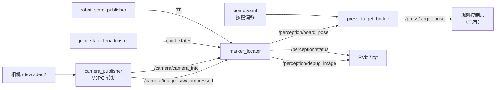

# 标定板识别与位姿解算 —— 框架设计（待检阅）

> 状态：**构思稿，未开工**。等确认文中「§8 待你拍板」的 5 个问题后再动手。
> 上游依赖：手眼标定结果（同事交付）。本文只设计**相机之后的链路**。

---

## 1. 这个模块干什么

```
相机图像  →  识别标定板  →  算板子在 base_link 下的位姿  →  (应用层) 换算成按压目标
```

拆成**两条链路**，因为它们的可验证性和稳定性完全不同：

| | 链路 1：板子位姿 | 链路 2：按压目标 |
|---|---|---|
| 输入 | 图像 + TF + 内参 | 链路 1 的输出 + 板系偏移 |
| 输出 | `/perception/board_pose` | `/press/target_pose` |
| 能否脱离机械臂验证 | ✅ 拿卷尺量就行 | ❌ 必须发下去看机械臂动 |

**分开的理由**：标定刚做完时你要验的是「板子位置算得准不准」，这时候
**不想让机械臂去按任何东西**。链路 2 只是一次坐标变换，纯数学，
不碰相机，可以单独测。

---

## 2. 接口（本文的核心）

### 2.1 输入

| 话题 | 类型 | 谁发 | 说明 |
|---|---|---|---|
| `/camera/image_raw/compressed` | `sensor_msgs/CompressedImage` | **新增** `camera_publisher` | MJPG 原样转发，**不解码**（见 §5.1）|
| `/camera/camera_info` | `sensor_msgs/CameraInfo` | 同上（读标定 YAML）| 内参 + 畸变，**同事交付的那份** |
| `/joint_states` | `sensor_msgs/JointState` | `joint_state_broadcaster` | 已有。用来判「臂停稳了没」|
| TF `/tf`, `/tf_static` | `tf2_msgs/TFMessage` | `robot_state_publisher` | 已有。`base_link ← wrist_depth_camera_optical_frame` |

**关键：`base_link ← 相机` 这条 TF 只能来自 TF 树**，也就是靠
① 手眼标定结果写进 URDF + ② `/joint_states`。
不能自己算正运动学 —— 那会和 URDF 各说各话，正是手眼标定要消灭的东西。

### 2.2 输出

| 话题 | 类型 | QoS | 说明 |
|---|---|---|---|
| `/perception/board_pose` | `geometry_msgs/PoseStamped` | RELIABLE, KEEP_LAST 1, VOLATILE | ⭐ **核心输出** |
| `/perception/debug_image/compressed` | `sensor_msgs/CompressedImage` | BEST_EFFORT, KEEP_LAST 1 | 画了检测框/坐标轴/重投影 |
| `/perception/status` | `diagnostic_msgs/DiagnosticArray` | RELIABLE, KEEP_LAST 1 | 检出数、重投影误差、距离、被拒原因 |

### 2.3 `/perception/board_pose` 的确切语义

```text
header.frame_id = "base_link"
header.stamp    = 图像采集时刻（不是处理完的时刻）
pose.position   = 板子原点，单位米
pose.orientation= 板子坐标系的姿态，单位四元数
```

**板子坐标系（板系）**：按 ArUco/OpenCV 的约定

| 轴 | 方向 |
|---|---|
| 原点 | 板子几何中心 |
| `+X` | 沿板子横轴向右（面向板子看）|
| `+Y` | 沿板子纵轴向上 |
| `+Z` | **垂直板面向外，指向观察者** |

⇒ **按压方向 = 板系的 −Z**（从板面压进去）。
⇒ 板子贴在竖直面板上、正对机械臂时，板系 −Z 就是机械臂的 +X 方向。

> ⚠️ 这个约定和 `drawMarker` 画出来的图一致：板子正着贴、相机正着看，
> `+Z` 就朝相机。**但是：板子贴反了靠位姿看不出来。**
>
> 实测（`selftest_offline.py`，2026-09-29）：贴反时从背面看，每个 marker 都是
> 镜像的，而镜像的 ArUco 图案不是合法编码 → 9 个里只剩 1 个能解出来。
> 但那 1 个**足够 `solvePnP` 拟合出一个朝前、指向正确、重投影误差只有
> 0.14 px 的位姿** —— 而且是错的。
>
> ⇒ **唯一可靠的信号是 marker 数量**（见 §5.4 的 `min_markers`）。
> 不要指望从解出来的位姿上看出贴反了。

### 2.4 链路 2 的输出：对接已有契约

`/press/target_pose` 的契约**已经写死在**`docs/perception_interface.md`，必须照做：

| 项 | 要求 | 本模块怎么满足 |
|---|---|---|
| 类型 | `geometry_msgs/PoseStamped` | ✅ |
| `frame_id` | 只能是 `world` 或 `base_link` | ✅ 我们本来就发 `base_link` |
| `position` | **压杆尖端的落点**，不是按钮中心/面板/法兰 | 由 `board.yaml` 给板系偏移 |
| `orientation` | 取 **+Z = 按压方向**，滚转角忽略 | `n = −R_base←board · Z` |
| `stamp` | 必须非零、新鲜（< 1 s） | 用采集时刻 |
| 工作空间盒 | `[-0.30,-0.50,-0.02] ~ [0.65,0.50,0.80]` m | 超了规划层会拒，我们要**提前自检并告警** |

**数学**（`t` = 平移，`R` = 旋转）：

$$
T_{base \leftarrow board} = T_{base \leftarrow opt} \cdot T_{opt \leftarrow board}
$$

$$
n = -R_{base \leftarrow board} \cdot \hat{Z}, \qquad
p_{tip} = t_{base \leftarrow board} + R_{base \leftarrow board} \cdot o_{tip}
$$

其中 $o_{tip}$ 是**板系下**的杆尖落点，写在 `board.yaml` 里。

---

## 3. 数据流



---

## 4. 模块结构

新建独立包（**感知和硬件控制不该混在一个包里**）：

```
src/Piper_ros/src/piper_marker_perception/
├── package.xml
├── CMakeLists.txt                  # ament_cmake，install(PROGRAMS ...)
├── config/
│   ├── board.yaml                  # 板子布局 + 杆尖偏移（人会改）
│   ├── camera_info_<相机>.yaml      # 同事交付的内参
│   └── marker_perception.yaml      # 节点参数默认值
├── launch/
│   └── marker_perception.launch.py # 起 camera_publisher + marker_locator
└── scripts/
    ├── camera_publisher.py         # 相机 → ROS 话题（无 OpenCV 依赖）
    ├── marker_locator.py           # ⭐ 检测 + solvePnP → board_pose
    └── press_target_bridge.py      # board_pose + 偏移 → /press/target_pose
```

**为什么用 `scripts/` + `install(PROGRAMS)` 而不是 C++**：整条链路是
I/O 密集 + 一次矩阵运算，Python 完全够；而且改参数不用重编，标定调试期
这点很重要。

---

## 5. 关键设计决定

### 5.1 图像走 `CompressedImage` 转发，不转成 raw

`camera_capture.py` 已经证明：MJPG 流里**每一帧本身就是一张完整 JPEG**，
按 `FFD8`/`FFD9` 切开就能零解码拿到。直接塞进
`sensor_msgs/CompressedImage` 转出去，**整个转发路径没有一次解码/编码**。

对比一下 1080p@15：

| 方案 | 每秒数据 | CPU |
|---|---|---|
| 转发 MJPG（本方案）| ~50 Mbps | ≈ 0（纯 memcpy）|
| 转成 raw bgr8 | 1920×1080×3×15 = **93 MB/s** | 每帧解码 + 序列化 |

而且 `marker_locator` 可以按**自己的节奏**解码（比如相机 15 fps，只处理 5 fps），
不用每帧都算。

### 5.2 ⚠️ 必须「臂停稳」才发布 —— 和采集脚本同一个理由

相机在**腕部**，所以 `T_base←optical` 随臂运动而变。而这条路径
**没有硬件曝光时间戳**（帧是用户态组装时才盖时间的），运动中的时间误差
会直接变成位置误差。

处理：**复用 `capture_session.py` 里验证过的那套** ——

1. 从 `/joint_states` 判静止（连续 N 次变化 < 阈值）
2. 静止后才解码 + 检测 + 查 TF
3. 连采 **M 帧**（默认 5），取中位数发布，同时报告离散度
4. 运动中：默认**不发**（可 `--allow-moving` 打开，但下游要自己判 `stamp`）

这对按压流程是**天然契合**的：机械臂先到"观察位姿" → 看一眼 → 再过去按。

### 5.3 位姿用 `solvePnP` 统一解，不用 `estimatePoseSingleMarkers`

`estimatePoseSingleMarkers` 是**逐 marker** 出一组位姿，多 marker 时你得自己
融合，而且它不用板子的整体布局约束。

更准的做法：把**所有**检出的 marker 的 4 个角点，按板子布局拼成
`objPoints` / `imgPoints`，**一次性 `solvePnP`**：

- 全部角点一起优化 → 精度随角点数提升（9 个 marker = 36 个点）
- 可以加 `solvePnPRansac` 抗 outlier
- 可以顺手算**重投影误差**当质量门

板子布局映射（板系 → 图像）由 `board.yaml` 的 `markersX/markersY/length/separation`
算出来，不依赖 `cv2.aruco.GridBoard`（容器里 4.5.4 有，但自己算更可控）。

**畸变不单独矫正**：直接把 `CameraInfo` 的畸变系数交给 `solvePnP` / `projectPoints`，
不要再插一步 `undistort`。少一次重采样 = 少一次精度损失，也少一次"忘了同步
K 与畸变"的机会。

### 5.4 三道质量门，不合格就不发

| 门 | 阈值（初值）| 不过会怎样 |
|---|---|---|
| 检出 marker 数 | ≥ `min_markers`（默认 4，板子 3×3=9）| 位姿没约束，乱飘 |
| 重投影 RMS | ≤ `max_reproj_px`（默认 2.0 px）| 解本身不可信 |
| 板子距离 | `min_distance`(0.15) ~ `max_distance`(1.0) m | 太远角点精度崩，太近出画 |

**被拒时 `/perception/board_pose` 不更新**，只有 `status` 报原因。
这样规划层拿到的一定是上一帧**合格**的位姿，而非一个垃圾值。

### 5.5 内参和板子布局分开放，都不写死在代码里

- `camera_info_*.yaml` —— 同事交付，直接喂 `CameraInfo`
- `board.yaml` —— 板子物理布局 + 杆尖偏移，**会换板子，会重贴**

分开是因为：**换板子不用重标内参，重标内参不用改板子。**

---

## 6. 配置

### `board.yaml`（人会手改的）

```yaml
board:
  dictionary: DICT_4X4_50        # 容器里 25 种字典都可用
  markers_x: 3
  markers_y: 3
  marker_length: 0.030           # m，实测，不是标称值
  marker_separation: 0.010       # m，两个 marker 之间的**间隙**
  first_marker_id: 0
  # 只认这些 ID，别的 marker 一律忽略（场景里可能有干扰）
  accepted_ids: [0, 1, 2, 3, 4, 5, 6, 7, 8]

press_rod_tip_in_board:          # ★ 杆尖落点，板系，单位 m
  x: 0.000
  y: -0.080
  z: 0.000
```

### `marker_perception.yaml`（一般不用改）

```yaml
marker_locator:
  ros__parameters:
    camera_info_file: ""         # 空 = 用话题上的 CameraInfo
    stationary_tolerance_rad: 0.002
    stationary_samples: 5
    average_frames: 5            # 静止后平均几帧
    min_markers: 4
    max_reproj_px: 2.0
    min_distance_m: 0.15
    max_distance_m: 1.0
    process_rate_hz: 5.0
    use_ransac: false
    publish_debug_image: true
```

---

## 7. 怎么验证（不靠机械臂）

| 层 | 方法 | 通过标准 |
|---|---|---|
| 检测 | `debug_image` 看框和 ID | 每个 marker 都框住、ID 对 |
| 解算 | 节点自报的**重投影 RMS** | < 1 px（< 2 px 可接受）|
| 一致性 | **不动板子，移动机械臂到 3 个不同位姿**，比 `board_pose` | 三个结果互相 < 2 mm |
| 绝对值 | 卷尺量板子原点到 base_link 的距离，对比 `board_pose.position` | < 5 mm（卷尺精度有限，主要抓粗错）|
| **是否贴反** | ⚠️ **只能看 marker 数量**（实测 9→1） | ≥ `min_markers`（板子是 9 个，建议 ≥ 6）|
| 端到端 | `ros2 topic echo /press/target_pose`，对齐 RViz 里的目标点 | 落点在按钮上 |

> **不要试图从位姿判断贴反**。实测：贴反时解出的位姿朝前、指向正确、
> 重投影误差 0.14 px，看起来和正常的一模一样。只有 marker 数量会塌。

> **「一致性」那一条最有价值**：它同时验证了手眼标定和识别链路。
> 换 3 个位姿后结果不变 = 两者都对；结果随位姿漂 = 手眼标定有问题。

---

## 8. ⚠️ 待你拍板

### 问题 1：**到底用 ArUco 还是 QR 码？**

你说的是「二维码」，但两者差别很大：

| | ArUco marker | QR 码 |
|---|---|---|
| 设计目的 | **专为位姿估计** | 数据存储 |
| 角点 | 4 个尖角，亚像素可达 0.1 px | 方块格，边缘模糊 |
| 多标记 | 可组板，一起优化 | 单码 |
| OpenCV 支持 | `cv2.aruco`，**完整**（含亚像素细化、板、ChArUco）| `cv2.QRCodeDetector`，只有 `detectAndDecode` 给 4 角 |
| 精度（同等尺寸）| **高一个档次** | 一般 |

**我的建议：ArUco**。除非你有现成的 QR 码必须用（比如现场已经有二维码）。

### 问题 2：**板子多大、几个 marker？**

按 $f \approx 1060$ px、距离 0.4 m、角点误差 0.2 px 估算：

| 板子有效尺寸 | 深度误差 | 横向误差 |
|---|---|---|
| 60 mm | ~0.5 mm | ~0.08 mm |
| **110 mm（3×3，30mm marker + 10mm 间隙）** | **~0.2 mm** | **~0.08 mm** |
| 200 mm | ~0.1 mm | ~0.08 mm |

按压本身要 ±1 mm 量级，**110 mm 的 3×3 板子已经绰绰有余**。
再大只是浪费空间、增加遮挡。

> 对比：单个 40 mm marker 只有 4 个角点，误差要大一档。
> 所以**不建议单 marker**。

**需要你确认**：板子印多大、能不能贴在面板上、离按钮多远。

### 问题 3：**相机怎么进容器？**（这是当前唯一的技术阻塞）

实测发现：

```
容器 piper_dev 里 /dev/video*  →  ✗ 完全看不到
                                  （compose 的设备透传是注释掉的）
容器里 v4l2-ctl               →  ✗ 没装
容器里 cv2 4.5.4 + aruco       →  ✓ 完整可用
host 上 /dev/video2            →  有，但 host 没有 rclpy
```

所以现在**「能读相机的」和「能跑 ROS 的」不在一台机器上**。三个选择：

| 方案 | 改什么 | 评价 |
|---|---|---|
| **A. `privileged: true`** | compose 去掉注释 | 最省事。容器是开发环境，可接受；compose 注释里本来就这么建议 |
| **B. `device_cgroup_rules: ['c 81:* rmw']`** | compose 加两行 | 更外科手术，只放开 video 设备。**推荐** |
| **C. 显式 `devices:` 挂 by-id** | compose + udev | 最精确但 `/dev/v4l/by-id` 在容器里不一定存在，容易踩坑 |

选 A 或 B 后，**还要往 Dockerfile 加 `v4l-utils`**（`camera_publisher.py` 用
`v4l2-ctl` 取 MJPG，和 `camera_capture.py` 同一套，已验证）。

> ⚠️ 改 compose 要**重建/重启容器**，`install/` 要重新 `colcon build`。

### 问题 4：**包名和位置**

我提议 `src/Piper_ros/src/piper_marker_perception/`。
也可以叫 `piper_fiducial_perception`、或者并到 `piper_elevator_manipulation` 里。
**你定。**

### 问题 5：**链路 2 的杆尖偏移谁来填？**

`press_rod_tip_in_board`（板系下按钮相对板子原点的位置）——
这个数是**物理测量**出来的，我没法算。

两种做法：
- **写在 `board.yaml`**（简单，换场景改文件）
- **加个"示教"模式**：手动把杆尖顶到按钮上，节点把当时板系下的位置记下来
  （更准，但要写额外的代码）

**建议先用手填 + §7 的验证核对。**

---

## 9. 建议的实施顺序

分 4 步，**每步都能独立验证**，不用等硬件全齐：

| 步 | 做什么 | 怎么验证 |
|---|---|---|
| **1** | `board.yaml` + 用 `cv2.aruco` 生成板子图纸（打印用）| 打印出来，尺子量 marker 边长 |
| **2** | `marker_locator` 的**离线版**：吃一张 `.jpg`，输出位姿 | 拍一张板子照片，跑一遍看重投影误差 |
| **3** | 接 ROS：`camera_publisher` + 静止门控 + 发布 | §7 的「一致性」验证 |
| **4** | `press_target_bridge` → `/press/target_pose` | `ros2 topic echo` + RViz |

第 2 步**不需要机械臂、不需要标定、不需要容器改配置**，
现在就能开始 —— 建议从这里切进去。

---

## 10. 一个诚实的提醒

手眼标定的残差会**原样进入**这条链路的误差。链路上游再有 5 mm 误差，
后面识别得再准也是 5 mm。

所以 §7 里「**移动机械臂到 3 个位姿，比 board_pose 是否一致**」
这条测试要**第一个做** —— 它决定了下游所有工作的上限。
