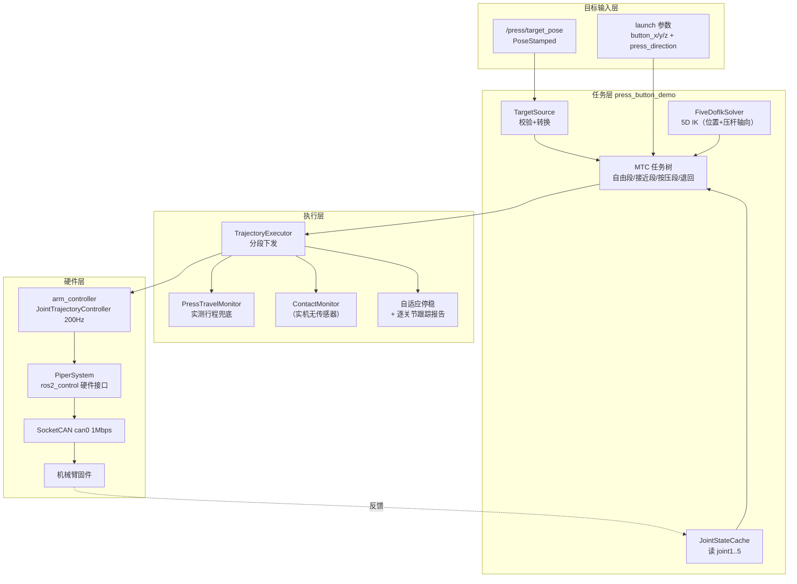

# 按压任务运行手册

> 交付目标：**给定世界坐标系里的一个目标点，机械臂完成对准、按压、退回，并回到原位。**
> 目标接口的完整约定见 `perception_interface.md`。
> 本文是操作手册，中文。

## 0. 一句话

发一条 `geometry_msgs/msg/PoseStamped` 到 `/press/target_pose`，
机械臂就去按那个点，按完退回起始位姿。

---

## 1. 完整运行命令

四个终端。容器内执行（宿主侧加 `sg docker -c 'docker exec -it piper_dev bash -lc "..."'`）。

### 终端 0 —— 上机前自检（每次开跑前都做）

```bash
ros2 run piper_elevator_manipulation preflight_check.py
```

看到 `=== CLEAN ===  safe to start a run` 才能继续。

> **为什么必须有这一步**：如果上次留下的 `ros2_control_node` 或 `move_group` 没退干净，
> 会出现**两个控制器同时往 can0 写关节指令**。现象是「机械臂反应很慢、卡在某个位姿不动」，
> 很容易误判成控制器或规划问题。2026-09-24 实际踩过：日志里
> `joint5 commanded -35.677 deg  measured +0.000 deg`，整段时间臂动都没动。
> 脚本会把多余进程的 PID 列出来，直接 `kill -9 <pid>` 即可。

### 终端 1 —— 硬件使能 + 控制器（常驻，不要关）

```bash
source /opt/ros/humble/setup.bash && source /ws/install/setup.bash

ros2 launch piper_hardware piper_real_bringup.launch.py \
    enable_motors:=true command_speed_ratio:=20
```

看到下面两行才算就绪：

```
[PiperSystem]: Arm feedback received. Current joint angles (deg): ...
[PiperSystem]: Motors enabled: the arm now holds its position under power. Keep the emergency stop within reach.
```

> **必须先使能电机**。失能时重力会把 joint2/joint3 压在**机械硬限位**上，
> 而硬限位在固件软限位之外，从那个位姿起步 5D IK 会退化（实测残差 4~11 mm）。

### 终端 2 —— 归位

```bash
ros2 run piper_elevator_manipulation go_home.py
```

参数在 `config/home_pose.yaml`，当前是
`joint1=0.0, joint2=+20.05°, joint3=-20.05°, joint4=0.0, joint5=0.0`。

### 终端 3 —— 按压任务（常驻）

```bash
ros2 launch piper_elevator_manipulation press_button_hardware.launch.py \
    target_source:=topic \
    max_presses:=0 \
    execute:=true hardware_enable:=true
```

`max_presses:=0` = 一直等目标，来一条按一次，方便反复测试。
设成 `max_presses:=1` 则按一次就退出。

> 两个开关必须同时为真：`execute:=true` **且** `hardware_enable:=true`。
> 少任何一个都只规划、不运动。

### 终端 4 —— 发目标点

```bash
# 例：按钮表面中心 (0.300, 0.000, 0.240) m，从前方水平压过去
ros2 run piper_elevator_manipulation send_press_target.py \
    --point 0.300,0.000,0.240 --direction 1,0,0
```

发一次按一次。也可以从你自己的节点发（见第 3 节）。

---

## 2. 调用框架



**分工**：规划层（MTC + IK）算出关节轨迹 → 控制器按 200 Hz 下发 → `PiperSystem` 转成 CAN 帧 → 固件执行伺服。

一次按压的时序：

1. 取目标 → 校验（坐标系、时间戳、工作空间盒）
2. 读 `joint1..5` 作为 MTC 起点
3. 加载 `config/free_motion_route.yaml` 的预录清除航点
4. 5D IK 求三个位姿：**对准点 / 目标点 / 按压终点**
   - 对准点 = 目标点 − `approach_distance` × 方向
   - 按压终点 = 目标点 + `press_depth` × 方向
5. MTC 规划：自由段 → 接近段（笛卡尔直线采样）→ 按压段 → 退回 → 回起点
6. 逐段执行，同时跑行程兜底监控
7. **自适应停稳**：等关节误差不再减小，打印逐关节命令 vs 实测
8. 从**实际停止状态**重新规划退回 + 回起点
9. 回到按压开始前的位姿

> **关于「go home」**：机械臂回到的是**按压开始前捕获的那一点**，不是配置里的归位姿态。
> 所以标准流程是从归位姿态开始（终端 2），这样按压结束后自然就是归位姿态。
> 如果你从别的位姿开始，按完需要再跑一次 `go_home.py`。

---

## 3. 传入目标点的接口

| 项目 | 值 |
| --- | --- |
| 话题 | `/press/target_pose` |
| 类型 | `geometry_msgs/msg/PoseStamped` |
| QoS | `RELIABLE` + `KEEP_LAST(1)` + `VOLATILE` |
| `header.frame_id` | `world` 或 `base_link`（**同一坐标系**，单位变换） |
| `position` | **压杆尖端**落点，米 |
| `orientation` | **+Z 轴 = 按压方向**（指向按钮内部），绕杆自转忽略 |

一次性发布：

```bash
ros2 run piper_elevator_manipulation send_press_target.py \
    --point X,Y,Z --direction DX,DY,DZ
```

从代码发布：

```bash
ros2 topic pub --once /press/target_pose geometry_msgs/msg/PoseStamped \
"{header: {frame_id: 'base_link'}, pose: {position: {x: 0.30, y: 0.0, z: 0.24}, \
  orientation: {x: 0.0, y: 0.7071068, z: 0.0, w: 0.7071068}}}"
```

（这个四元数是 90° 绕 Y，对应 +Z 指向 base 的 +X，也就是水平向前压。完整说明和可抄的
Python 发布示例在 `perception_interface.md`。）

会被拒绝、且**不会动机械臂**的情况：`frame_id` 空或未知、`stamp` 为 0 或过期超过 1 s、
有 nan/inf、四元数没填、点在工作空间盒外。

---

## 4. 参数速查

| 参数 | 默认 | 说明 |
| --- | --- | --- |
| `target_source` | `parameters` | `topic` 走话题；`parameters` 用 `button_x/y/z` |
| `target_topic` | `/press/target_pose` | 订阅话题名 |
| `max_presses` | `1` | 按几次后退出；`0` = 一直跑 |
| `target_wait_timeout_s` | `0` | 等不到目标的超时；`0` = 一直等 |
| `target_max_age_s` | `1.0` | 目标最大允许陈旧时间 |
| `press_direction_sign` | `+1` | `-1` = 把方向反号（你们发外法线时用） |
| `workspace_min` / `workspace_max` | `[-0.30,-0.50,-0.02]` / `[0.65,0.50,0.80]` | 工作空间盒（米） |
| `approach_distance` | `0.030` | 对准点离按钮表面的距离（米） |
| `press_depth` | `0.003` | 按压前进距离（米），**实机无接触传感器，这个值就是停止条件** |
| `hardware_travel_margin_m` | `0.003` | 实测行程硬上限 = `press_depth + margin` |

### 速度怎么调

速度由**两**组参数相乘决定，搞清分工就不会调错：

1. `piper_press_moveit/config/joint_limits.yaml` 里的 `max_velocity: 3.0`、
   `max_acceleration: 5.0` —— 这是**厂商给的硬件上限**（SDK：速度 0.001 rad/s × [0,3000]，
   加速度 0.01 rad/s² × [0,500]）。**不要为了调快慢改这里。**
2. `config/free_motion_route.yaml` 里的缩放系数 —— **要调快慢就改这里**：

| 参数 | 当前 | 控制的动作 |
| --- | --- | --- |
| `free_motion.velocity_scaling` | `0.20` | 自由段速度（也用于 OMPL 兜底分支和回原点） |
| `free_motion.acceleration_scaling` | `0.20` | 自由段加速度 |
| `cartesian.approach_speed_scaling` | `0.10` | 接近段速度 |
| `cartesian.press_speed_scaling` | `0.02` | 按压段速度（**别随意调大**，无传感器） |
| `cartesian.retreat_speed_scaling` | `0.08` | 退回段速度 |

`cartesian.*` 这三个上限是 0.2（`speedScaling()` 校验），`free_motion.*` 上限是 1.0。

**「又慢又抖」怎么调**：加速度比速度更影响手感。先看 `acceleration_scaling`，
加速度太低会让轨迹永远在加/减速、到不了匀速段，看起来就是一顿一顿的。

**每次规划后日志会打印各阶段计划时长**，不用动机械臂就能验证调速效果：

```
[INFO]   planned via clearance                       0.90 s
[INFO]   planned advance to button contact           1.63 s
[INFO]   planned total (motion only)                 7.33 s
```

### 执行闸门

| 参数 | 默认 | 说明 |
| --- | --- | --- |
| `execute` | `false` | 运行已校验的轨迹 |
| `hardware_enable` | `false` | 第二个闸门，实机必须显式打开 |

固定点位也可以不用话题，直接给参数：

```bash
ros2 launch piper_elevator_manipulation press_button_hardware.launch.py \
    execute:=true hardware_enable:=true \
    button_x:=0.300 button_y:=0.000 button_z:=0.240 \
    press_direction_x:=1.0 press_direction_y:=0.0 press_direction_z:=0.0
```

---

## 5. 今天验证过的 / 没验证的

**已验证**

| 项目 | 结果 |
| --- | --- |
| 归位动作（`go_home.py`） | 五关节全部到位，最大误差 **0.082°** |
| 话题接口四条拒绝路径 | 四元数没填 / 未知 frame / 超出工作空间 / 无目标超时，全部按预期拒绝且不动臂 |
| 量纲换算 | `send_press_target.py` 的六组方向反解 +Z 误差 ≤ 2.2e-16 |
| 端到端 dry-run | 话题目标 → 起点捕获 → 5D IK → `path_source=prerecorded` → **规划成功**（未运动） |
| 实机全流程（今天之前） | `SUCCESS: fixed-travel press completed; arm retreated and returned` |

**新增的诊断（本次改动）**

执行时现在会打印逐关节的**命令值 vs 实测值**：

```
[INFO] Joint tracking at approach end:
[INFO]   joint1  commanded   +0.000 deg  measured   +0.000 deg  lags by  +0.000 deg
[INFO]   joint2  commanded  +20.054 deg  measured  +20.038 deg  lags by  -0.016 deg
[INFO]   ...
[INFO]   worst joint lag: 0.036 deg on joint3
[INFO] Actual TCP at approach end: (...), axial offset from target 0.0022 m
```

原来这里是盲等固定 500 ms；现在等关节误差**不再减小**才继续，所以「还在追」和
「就只能到这」能区分开。这个数字决定按压力度要留多少余量。

**还没验证**

- 实机 Execute 全流程（需要你给真实目标点，并且台面清空）
- 接触停止（实机没有力/接触传感器）
- 急停、控制器故障恢复

---

## 6. 故障排查

### 症状：机械臂反应很慢、卡在某个位姿不动

**先做这个**：

```bash
ros2 run piper_elevator_manipulation preflight_check.py
```

如果是 `NOT CLEAN`，按它给出的 PID `kill -9`，然后**重启终端 1 的 bringup**
（控制器管理器退出会失能，臂会落到硬限位上），再跑一次 `go_home.py`。

**验证是不是这个问题**：在终端 3 的日志里找

```
[INFO] Joint tracking at approach end:
[INFO]   joint2  commanded  +51.275 deg  measured  +20.041 deg  lags by -31.234 deg
[INFO]   worst joint lag: 35.677 deg on joint5
```

`measured` 那一列如果一直等于**起始位姿**、和 `commanded` 差几十度，就是重复实例，
不是控制问题。正常运行时这一列应该跟着 `commanded` 走，最后 lag 在 0.1° 量级。

### 症状：终端 1 里出现 `Failed loading controller` / `Controller already loaded`

```
[spawner_joint_state_broadcaster]: Failed loading controller joint_state_broadcaster
[spawner_arm_controller]: Controller already loaded, skipping load_controller
[spawner_arm_controller]: Failed to configure controller
[controller_manager]: Could not configure controller with name 'arm_controller'
                     because no controller with this name exists
```

**这个报错很有误导性 —— 它看起来像控制器配置问题，实际含义是「已经存在另一个
controller manager」**。spawner 问一个 manager、配置的是另一个，所以会同时出现
「已经加载了」和「不存在这个控制器」两种自相矛盾的提示。

成因：bringup 跑了两个实例（常见于上一个没退干净又启了一个）。

**现在已加硬性防护**：`piper_hardware/piper_real_bringup.launch.py` 启动时会扫
`/proc` 找 `ros2_control_node`，发现已有的就**直接报错退出**，并给出要杀的 PID。

如果你看到的是这个拒绝信息，按它给的命令做：

```bash
kill -9 <pid>          # 用 -9！普通 kill 会走失能钩子，臂会掉到硬限位
# 然后重新跑终端 1
ros2 run piper_elevator_manipulation go_home.py
```

### 症状：一直没反应，日志停在 `Waiting for a press target`

目标消息是 `VOLATILE` 的，**发早了就丢了**（终端 3 的 `press_button_demo` 要等
move_group 起来，launch 里有 10 s 延迟）。等终端 3 打出
`Waiting for a press target on '/press/target_pose'` 之后再发目标。

### 症状：目标被拒

日志里会有明确原因（`unknown frame` / `target is N s old` / `orientation is not a
rotation` / `outside the accepted workspace box`）。对照 `perception_interface.md` 第 5 节。

### 症状：`RECOVERY_FAILED: no validated retreat/return from actual state`

通常是**上一步没到位**的连锁反应：退回段要求起点和按压点在同一条面板法线直线上，
如果臂没走到接近点，这个几何条件不成立，退回自然规划不出来。
先解决「为什么没到位」，别单独去调恢复逻辑。

---

## 7. 已知问题与下一步

1. **接近结束时约有 2.2 mm 轴向偏差**。真实原因待确认 —— 新加的逐关节报告就是用来分这个：
   - 如果某一两个关节有明显稳态偏角 → 是**负载下的关节弹性/重力下垂**，等再久也不会好，
     需要在标定阶段补偿
   - 如果所有关节都在缓慢收敛 → 是**控制器还没追上**，把停稳时间放宽即可
   不管哪种，**都不是插补器的问题**，所以换 `piper_sdk` 的点到点（固件插补）并不能解决它。

2. **规划场景是空的**。MoveIt 不知道桌子、面板、障碍物在哪，碰撞检查目前只查自碰撞。
   在有相机或工作台标定数据之前，上实机前请人工确认路径是空的。

3. **按压是固定行程，不是力控**。`press_depth` 就是停止条件，
   `hardware_travel_margin_m` 是独立的实测行程兜底。真实按钮需要力/位移反馈才算闭环。

4. **除 `world`/`base_link` 外的坐标系还不能用**（没接 TF 变换）。
   感知如果输出在相机系，需要先补这一层。

完整待办见 `todo.md`。
